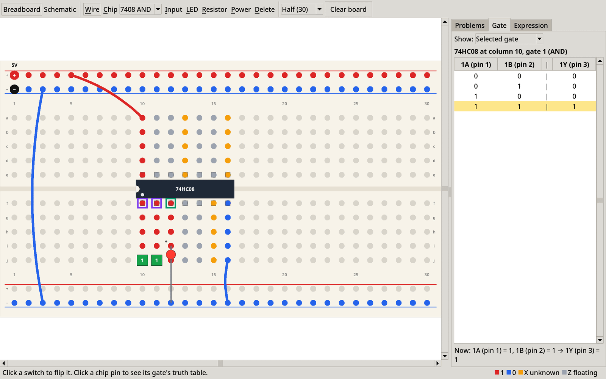
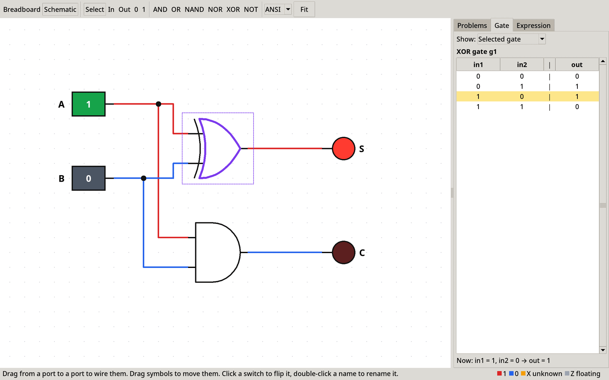
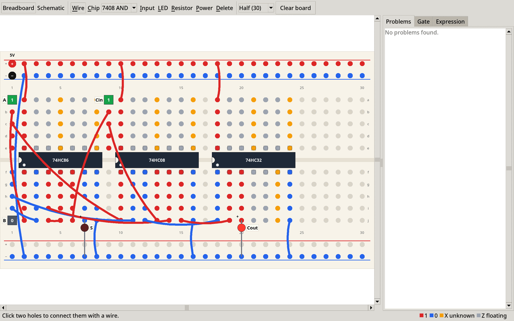
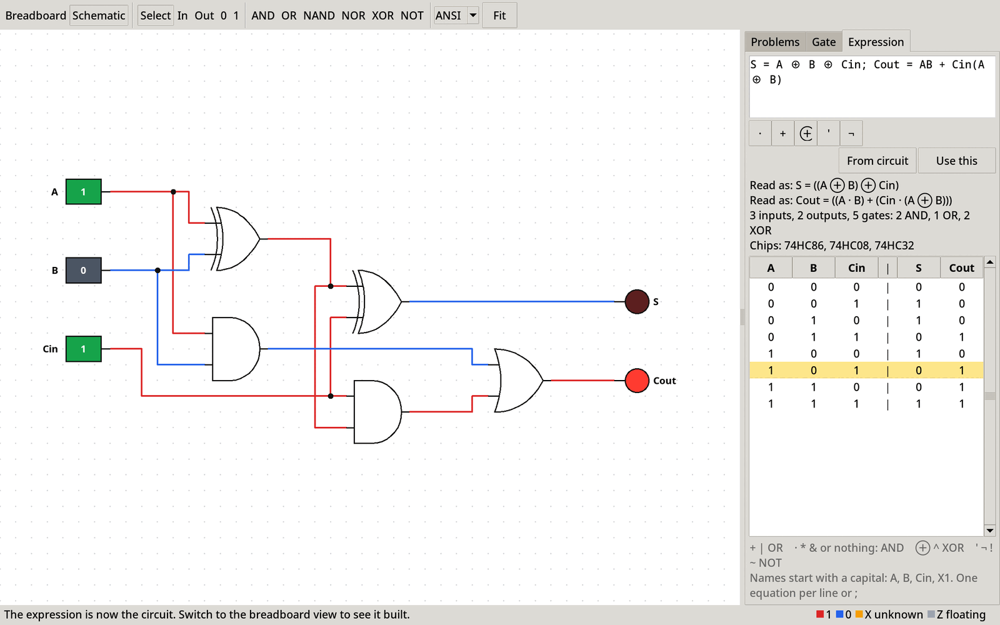

# Breadboard simulator: user guide

A simulator for digital logic circuits. You build circuits on a virtual
breadboard with 74HC chips, switches and LEDs, as in the IN1020 lab. You can
also draw a circuit with gate symbols or type it as a Boolean expression, such
as `F = A + B·C'`. The simulator runs the circuit as you build it: flip a switch
and the LEDs, wires and holes show the new values straight away.

How it works inside is described in [design.md](design.md). This guide is about
using it.

**Contents**

1. [Getting started](#1-getting-started)
2. [The window](#2-the-window)
3. [Your first circuit: an AND gate on the breadboard](#3-your-first-circuit-an-and-gate-on-the-breadboard)
4. [Running and testing a finished circuit](#4-running-and-testing-a-finished-circuit)
5. [Building on the breadboard](#5-building-on-the-breadboard)
6. [The schematic view: circuits as gate symbols](#6-the-schematic-view-circuits-as-gate-symbols)
7. [Expressions](#7-expressions)
8. [From the simulator to a real breadboard](#8-from-the-simulator-to-a-real-breadboard)
9. [Keyboard and mouse](#9-keyboard-and-mouse)
10. [Troubleshooting](#10-troubleshooting)
11. [Limitations](#11-limitations)

---

## 1. Getting started

**You need** Python 3.10 or newer with tkinter. No other packages are needed.

| System | tkinter |
|--------|---------|
| Fedora | `sudo dnf install python3-tkinter` |
| Debian / Ubuntu | `sudo apt install python3-tk` |
| Windows, macOS (installers from python.org) | included |

**To start the simulator**, open a terminal in the project folder (the one with
`breadboard/` and this guide in it) and run:

```
python3 -m breadboard.ui
```

The window opens at 80 % of the screen. Everything scales with the window, so
make it as large as you like.

**To check the installation** (optional):

```
python3 -m unittest
```

This runs the tests and should end with `OK`.

---

## 2. The window



- **Toolbar** (top). *Breadboard* and *Schematic* switch between the two views
  (Ctrl+Tab). The rest of the toolbar holds the tools of the current view.
- **The board or schematic** (left). This is where you build.
- **Side panel** (right), with three tabs:
  - **Problems**: what is wrong with the circuit, e.g. a chip without power. The
    tab title shows the number of problems.
  - **Gate**: the truth table of the gate you clicked.
  - **Expression**: type a circuit as equations, or see your circuit as equations.

  Drag the divider to resize the side panel. F9 hides and shows it.
- **Status bar** (bottom). On the left, help for the tool you have selected
  (red for errors). In the middle, the colour legend. On the right, what is
  under the mouse.

**Colours.** Holes, wires and chip legs are coloured by the value they carry:

| Colour | Value | Meaning |
|--------|-------|---------|
| red | 1 | high |
| blue | 0 | low |
| amber | X | unknown: conflicting outputs, an input that isn't connected, a latch that hasn't been set, or an oscillation |
| grey | Z | floating: nothing drives it |
| light | | not connected to anything |

---

## 3. Your first circuit: an AND gate on the breadboard

You will build one AND gate with two switches and an LED. The hole names are
printed along the edges of the board: rows `a`–`j` and columns `1`–`30`. The
power rails are `T+` and `T−` at the top and `B+` and `B−` at the bottom.

The board starts with a 5 V power supply in the top rails: **+** in T+1 and
**−** in T−1.

1. **Place the chip.** Pick **Chip** in the toolbar and choose `7408 AND` in the
   menu next to it. Click any hole in **column 10**. The 74HC08 now sits across
   the middle channel. Pin 1 is in hole f10, pins 1–7 run along row f
   (f10–f16), and pins 14–8 run along row e (e10–e16). The notch is on the left.
2. **Give the chip power.** Pick **Wire**.
   - Click **a10**, then **T+5**. Pin 14 (VCC) is in e10, and a10 is in the same
     column strip, so this connects VCC to +5 V.
   - Click **T−3**, then **B−3**. This connects the bottom − rail to ground.
   - Click **j16**, then **B−16**. Pin 7 (GND) is in f16, so this connects it to
     ground.
3. **Add two switches.** Pick **Input** and click **j10** and **j11**. These are
   the strips of pin 1 (1A) and pin 2 (1B). The switches start at 0.
4. **Add an LED.** Pick **LED**, click **i12** (the anode, +, in the strip of
   pin 3, the gate's output 1Y), then click **B−12** (the cathode, −, on
   ground).
5. **Run it.** Click the switches; this works with any tool selected. The LED
   lights only when both switches are 1. This is the AND truth table.

The Problems tab should say *No problems found*. If you skip the VCC wire in
step 2, it says *74HC08 at column 10 is not powered* and the LED stays off.

Holes in the same strip are connected. A strip is the five holes a–e of one
column, or the five holes f–j of one column. Each rail is one long strip. So in
step 2 you could have used b10, c10 or d10 instead of a10. Hover over any hole
to see which net it belongs to and its value.

---

## 4. Running and testing a finished circuit

A circuit runs all the time: every change is simulated straight away. There is
no start button. "Running" a circuit means setting its inputs and reading its
outputs.

### Set the inputs

- **On the breadboard**, click a switch to flip it between 0 and 1. A green
  switch is 1, a dark one is 0. This works with any tool except Delete.
- **In the schematic view**, click an input symbol. The two views stay in step:
  flipping a switch in one flips it in the other.

### Read the outputs

- **LEDs** light (bright red) when their anode is 1 and their cathode is 0.
  Dark red means off, and amber means the value is unknown (X).
- **Every hole, wire and chip leg** is coloured by its value, so you can follow a
  signal through the circuit by its colour.
- **Hover** over a hole to see its exact value, e.g. `h12: net bot12 = 1`. On a
  chip pin you also see the pin's name, e.g. `74HC08 pin 3 (1Y)`. "(weak)" means
  the value only comes through a resistor.
- **In the schematic view**, output lamps light up and wires are coloured the
  same way. Hover over a wire to highlight its whole net.

### Test every combination

1. Go through all input combinations: 00, 01, 10, 11 for two inputs, and so on
   (2ⁿ combinations for n inputs). Write down the outputs and compare them with
   the truth table you expected.
2. Or let the simulator write the table: open the **Expression** tab and press
   **From circuit**. You get your circuit as equations, e.g. `F = A ⊕ B`, and
   below it the full truth table of what you actually built. If the equations
   or the table aren't what you meant, the circuit is wired differently from
   what you intended.
3. When a circuit was made from an expression with **Use this** (§7), the
   row of the table that matches the current switches is highlighted, so you
   can watch it move as you flip them.

### Look at one gate at a time

Click a chip pin on the breadboard (with any tool except Delete), or a gate in
the schematic view. The **Gate** tab then shows:

- the gate's truth table, with the datasheet pin names (1A, 1B → 1Y)
- the row for the gate's current inputs, highlighted
- a *Now* line with the actual values, including X and Z. For example,
  `Now: 1A (pin 1) = 1, 1B (pin 2) = Z → 1Y (pin 3) = X` means pin 2 isn't
  connected.

Clicking pin 7 or 14 (GND or VCC) shows the whole chip's pinout with the current
value on every pin. The *Show* menu also lists every gate type, so you can look
up a truth table without placing anything.

### Check the Problems tab

| Message | What to do |
|---------|------------|
| `74HC08 at column 15 is not powered` | Wire pin 14 (row e, first column of the chip) to + and pin 7 (row f, last column of the chip) to −. |
| `74HC08 at column 15: input pin 2 is floating` | Nothing drives that input. Wire it to a switch, a gate output or a rail. |
| `short circuit on net T-` | Two things drive the same net with different values, for example a wire from + to −, or two outputs wired together. |
| `oscillation at …` | The circuit never settles, such as a ring of an odd number of inverters. The values show X. |
| `the name A is used twice` | Two switches or LEDs have the same label. Rename one. |

Unused gates on a chip are not reported, so three empty gates on a 74HC08 are
fine.

### Circuits with memory (latches)

A circuit with feedback, such as an SR latch, remembers its state:

- **At the start** its outputs are **X** (amber), because the state is unknown,
  just as on real hardware right after power-up.
- **Set it** (S = 1, then S = 0) and Q stays 1. **Reset it** (R = 1, then R = 0)
  and Q stays 0.
- **The state survives** rewiring other parts of the board and switching between
  the breadboard and schematic views.
- **In the truth table**, the "hold" row (S = R = 0) shows X, because it depends
  on what happened before. Flip the switches to see the actual behaviour.

The quickest way to try one is to type `Q = (R + Qn)'; Qn = (S + Q)'` in the
Expression tab and press **Use this** (§7).

---

## 5. Building on the breadboard

### Tools

| Tool | Key | How |
|------|-----|-----|
| Wire | W | Click two holes. |
| Chip | C | Choose the chip in the menu, then click a column: pin 1 goes in row f of that column. |
| Input | I | Click a hole to add a switch. Click a switch to flip it. |
| LED | L | Click the anode (+) hole, then the cathode (−) hole. |
| Resistor | R | Click the holes for its two legs. |
| Power | P | Click the + hole, then the − hole (a second supply; the board starts with one). |
| Delete | D | Click a part to remove it. |

- **Right-click** any part to remove it, whatever tool is selected.
- **Esc** cancels a part you have started (after the first hole).
- **Each hole holds one part.** If a hole is taken, use another hole in the same
  strip; it is the same connection.
- The keyboard shortcuts work while the mouse is over the board.

### Chips

A chip takes 7 columns, rows e and f, across the channel. The simulator has
these 74HC chips:

| Chip | Gates | 1 | 2 | 3 | 4 | 5 | 6 | 7 | 8 | 9 | 10 | 11 | 12 | 13 | 14 |
|---|---|---|---|---|---|---|---|---|---|---|---|---|---|---|---|
| 74HC00 | 4 × NAND | 1A | 1B | 1Y | 2A | 2B | 2Y | GND | 3Y | 3A | 3B | 4Y | 4A | 4B | VCC |
| 74HC02 | 4 × NOR | 1Y | 1A | 1B | 2Y | 2A | 2B | GND | 3A | 3B | 3Y | 4A | 4B | 4Y | VCC |
| 74HC04 | 6 × NOT | 1A | 1Y | 2A | 2Y | 3A | 3Y | GND | 4Y | 4A | 5Y | 5A | 6Y | 6A | VCC |
| 74HC08 | 4 × AND | 1A | 1B | 1Y | 2A | 2B | 2Y | GND | 3Y | 3A | 3B | 4Y | 4A | 4B | VCC |
| 74HC32 | 4 × OR | 1A | 1B | 1Y | 2A | 2B | 2Y | GND | 3Y | 3A | 3B | 4Y | 4A | 4B | VCC |
| 74HC86 | 4 × XOR | 1A | 1B | 1Y | 2A | 2B | 2Y | GND | 3Y | 3A | 3B | 4Y | 4A | 4B | VCC |

*n*A and *n*B are the inputs of gate *n*, and *n*Y is its output. Note that the
74HC02 has its outputs first. If you place a chip at column *c*:

```
   row e:   e(c)  e(c+1) … e(c+6)        pins 14 13 12 11 10  9  8
            ┌──────────────────────┐
            ◖  chip                 │
            └──────────────────────┘
   row f:   f(c)  f(c+1) … f(c+6)        pins  1  2  3  4  5  6  7
```

**Every chip needs power:** pin 14 (VCC, hole e*c*) to + and pin 7 (GND, hole
f(*c*+6)) to −. Without it the outputs float (Z), and the Problems tab says the
chip isn't powered.

### LEDs and resistors

- **An LED lights when its anode is 1 and its cathode is 0.** Put the cathode
  straight into a − rail, or connect it through a resistor to −. The simulator
  doesn't model current, so both work.
- **A resistor is a weak connection.** It passes a value on only if nothing
  else drives the other side, so it works as a pull-up (to +) or a pull-down
  (to −). A real output always wins over a resistor.

### Board size

The menu next to the tools switches between a half-size board (30 columns) and a
full-size one (63). **Clear board** (or *File → New board*) removes everything
except the power supply.

---

## 6. The schematic view: circuits as gate symbols

Press **Schematic** in the toolbar, or Ctrl+Tab. The same circuit is now drawn
with gate symbols.

### Seeing your breadboard as a schematic

If you built the circuit on the breadboard, the schematic view shows it as
symbols, with the board's live values:

- **Switches** become inputs, named A, B, C… from left to right (or by the name
  you give them), and **LEDs** become outputs F, G, H….
- **Each gate in use** on a chip becomes one gate symbol. The chip's unused
  gates are left out.
- **Clicking an input symbol** flips the board's switch.
- **Moving symbols** to tidy the drawing is allowed, and the positions are kept
  when you change the board later.
- **Double-clicking a name** renames it. The name is also shown on the board.

### Designing a circuit with symbols



Here is a half adder (sum S = A ⊕ B, carry C = A·B), built from symbols:

1. Choose *File → New schematic* to start from an empty schematic. If there is
   a circuit on the breadboard, the simulator asks before it replaces it (see
   [Which one is the circuit?](#which-one-is-the-circuit)). Press **Schematic**
   if the view hasn't switched.
2. Pick **In** and click twice, a little apart, on the left: inputs **A** and
   **B** appear.
3. Pick **XOR** and click to the right of them; pick **AND** and click below the
   XOR.
4. Pick **Out** and click twice on the right: outputs **F** and **G**.
   Double-click a name to rename it, for example F to **S** and G to **C**.
5. Pick **Select** (S). Wire the circuit by **dragging from a port to a port**.
   Ports are the ends of the short lines on a symbol: inputs on the left,
   outputs on the right.
   - A → the XOR's top input, and A → the AND's top input
   - B → the XOR's bottom input, and B → the AND's bottom input
   - the XOR's output → S, and the AND's output → C

   An unconnected input is marked with a small red ring. To connect one output
   to several inputs, drag from the output again, or start the drag on the
   wire that is already there.
6. **Run it:** click A and B and watch S and C. The Problems tab lists anything
   still unconnected.

**Symbols need room:** two free grid columns beside and one free grid row above
and below each symbol. A placement or move that is too close is refused, with
*Too close to another symbol*, and the symbol stays where it was. Wires are
routed automatically around the symbols. If one can't be routed, it is drawn
dashed, and the Problems tab says to move symbols apart.

### Editing

| To | Do |
|----|----|
| Place a symbol | Pick it in the toolbar and click on the canvas. **0** and **1** are constants. |
| Connect | Drag from a port to a port, in either direction. While you drag, the ports that would accept the wire are circled in green. |
| Replace a connection | Drag a new wire onto an input that is already connected. The status bar says which wire was replaced. |
| Branch | Start dragging on an existing wire. |
| Move | Drag a symbol. Drag a rectangle on empty space to select several, then drag one of them. Arrow keys nudge the selection. |
| Delete | Right-click a symbol or a wire, or select and press Delete. |
| Rename an input or output | Double-click its name. |
| Flip an input | Click it. |
| See a gate's truth table | Click the gate (Gate tab). |
| Zoom, scroll, fit | Ctrl+wheel zooms at the mouse, the wheel scrolls (Shift+wheel sideways), middle-drag pans, **Fit** (F) shows everything. |
| Undo, redo | Ctrl+Z, Ctrl+Y. |
| Save, open | Ctrl+S, Ctrl+O, or the File menu. Schematics are saved as `.json` files. |
| Symbol style | The **ANSI** / **IEC** menu: American shapes or European boxes (&, ≥1, =1, 1). |

### From schematic to breadboard



When you designed the circuit in the schematic (or typed it as an expression),
press **Breadboard** to see it built with real chips. The simulator chooses the
chips, places them, wires their power, and adds a labelled switch for every
input and a labelled LED for every output. The switches work on this board too,
and both views stay in step. Use the hole names to copy it onto a real
breadboard (§8).

### Which one is the circuit?

The breadboard and the schematic are two views of one circuit. The view you
edited last is the circuit, and the other one is drawn from it:

- **If you built on the breadboard,** the schematic is drawn from the board. If
  you then change the schematic (add, delete or rewire something), the simulator
  asks first:
  *The breadboard will be rebuilt from the schematic, and its hand-placed wiring
  will be lost.* Press **Cancel** to keep your board. Undo can't bring it back
  afterwards.
- **If you drew a schematic or used an expression,** the breadboard is built from
  it. If you change that board by hand, the board becomes the circuit, and the
  schematic is drawn from it again, keeping your symbol positions.
- **Moving symbols, flipping switches and renaming** don't change the circuit,
  so they never ask.

---

## 7. Expressions

Open the **Expression** tab and type one or more equations:

```
S = A ⊕ B ⊕ Cin
Cout = AB + Cin(A ⊕ B)
```

| Meaning | Type | Examples |
|---------|------|----------|
| OR | `+` or `\|` | `A + B` |
| AND | `·` `*` `&`, or nothing | `A·B`, `AB`, `A(B + C)` |
| XOR | `⊕` or `^` | `A ⊕ B` |
| NOT | `'` after, or `¬` `!` `~` before | `A'`, `(AB)'`, `¬A` |
| constants | `0` `1` | `A·1` |

- **Precedence**, from tightest to loosest: NOT, AND, XOR, OR. So `A + BC'`
  means `A + (B·(C'))`. Use parentheses when in doubt. The tab shows how it read
  your expression (*Read as*, fully parenthesised).
- **Names** start with a capital letter, followed by lowercase letters, digits
  or `_`: `A`, `Cin`, `X1`. That's why `AB` means A·B while `Cin` is one name.
- **One equation per line**, or separate them with `;`. An expression without
  `Name =` is called F. Equations can use each other's names, in any order.
- **Typing symbols:** the buttons below the text box insert `·` `+` `⊕` `'` `¬`.
  The keyboard versions (`*`, `^`, `!`) work just as well.

While you type, the tab shows how the expression was read, how many gates and
which chips it needs, and its truth table. A mistake is marked in red, with a
message such as *Expected a name, 0, 1 or '(', found '*'*.



**Use this** makes the expression the circuit. It is drawn as a schematic, and
pressing **Breadboard** shows it built on chips. Flip the inputs in either view,
and the truth table highlights the row for the current switches.

**From circuit** does the opposite: it writes the current circuit, from the
breadboard or the schematic, as equations. If the circuit has an unconnected
input, it says which one instead.

**Try a latch:** type `Q = (R + Qn)'; Qn = (S + Q)'` and press Use this. The tab
notes that the circuit has feedback. The schematic is two cross-coupled NOR
gates, and on the breadboard it is one 74HC02. Then follow the steps in
§4 *Circuits with memory*.

---

## 8. From the simulator to a real breadboard

A circuit that works in the simulator can be copied onto a real half-size
breadboard hole by hole. The simulator's hole names (rows a–j, columns 1–30)
follow the usual printed labels. Things the simulator lets you skip, but a real
circuit needs:

- **Check the lab instructions** for the supply voltage and how the power is
  connected. The simulator assumes 5 V, which suits 74HC chips.
- **Put a resistor in series with every LED** (a few hundred ohms is typical;
  use the value the lab tells you). The simulator doesn't model current, so it
  lights an LED without one, but a real LED needs it.
- **Don't leave inputs floating.** In the simulator a floating input just shows
  X. On a real CMOS chip it can behave randomly, so tie unused inputs to + or −.
- **Mind the chip's orientation.** The notch (or dot) marks the pin 1 end. The
  simulator draws chips with the notch to the left and pin 1 bottom-left, in row
  f.
- **Rails are not always connected across the board.** On some real boards the
  rails are split in the middle. In the simulator each rail is one strip, and
  the top and bottom rails are only connected if you add wires.

---

## 9. Keyboard and mouse

**Everywhere**

| Key | Action |
|-----|--------|
| Ctrl+Tab | switch between the breadboard and schematic views |
| F9 | hide or show the side panel |

**Breadboard** (with the mouse over the board)

| Key / mouse | Action |
|-------------|--------|
| W C I L R P D | Wire, Chip, Input, LED, Resistor, Power, Delete |
| Esc | cancel the part you started |
| click | use the tool; flip a switch; select a chip pin's gate |
| right-click | remove a part |
| hover | hole name, net and value (and the pin name on chips) |

**Schematic** (with the mouse over the schematic)

| Key / mouse | Action |
|-------------|--------|
| S I O | Select, In, Out |
| 1 – 6 | AND, OR, NAND, NOR, XOR, NOT |
| F | fit everything in the window |
| Delete / Backspace | delete the selection |
| arrow keys | nudge the selection |
| Ctrl+A | select everything |
| Esc | clear the selection (press again for the Select tool) |
| Ctrl+Z / Ctrl+Y | undo / redo |
| Ctrl+S / Ctrl+O | save / open a schematic |
| drag from a port | draw a wire |
| click / double-click | flip an input, select a gate / rename |
| right-click | delete a symbol or wire |
| Ctrl+wheel, wheel, Shift+wheel, middle-drag | zoom, scroll, scroll sideways, pan |

---

## 10. Troubleshooting

**The LED doesn't light.** Go through these:

1. **Power:** does the Problems tab say the chip is not powered? Wire pin 14 to +
   and pin 7 to −.
2. **Bottom rails:** if you use them, they must be wired to the top rails (T+ to
   B+, T− to B−).
3. **LED the right way round:** the anode (+, first click) goes on the signal,
   and the cathode (−, second click) on ground.
4. **The signal itself:** hover over the anode's hole. If the value is 0, the
   circuit's output really is 0; check the inputs and the Gate tab. If it is X
   or Z, something earlier isn't connected.

**"Hole … is already in use".** Every hole takes one part. Use another hole in
the same strip; it's the same connection.

**"Hole f31 is off the board".** The chip doesn't fit there. A chip needs 7
columns, so place it further left, or switch to the full-size board.

**Everything is amber (X).** A short circuit (see the Problems tab) can make a
whole rail X, for example a wire from + to −.

**A latch shows X.** It hasn't been set or reset yet; see §4.

**"Too close to another symbol".** Leave two free grid columns beside, and one
free row above and below, every symbol.

**A dashed wire in the schematic.** It couldn't be routed around the symbols.
Move them further apart, or press Fit and make room.

**"This circuit can't be built on a breadboard".** The schematic contains a
gate type no chip provides (for example a 3-input AND from a saved file).

**The window or text is too small or too big.** Everything scales with the
window. Drag the divider to give the board more room, press F9 to hide the side
panel, and press Fit in the schematic view.

---

## 11. Limitations

- **No timing.** Gates switch instantly, so glitches and races don't show up.
- **No electricity.** There are no voltages, currents or resistor values, only
  0, 1, X and Z.
- **Gates have two inputs** (NOT has one). `ABC` is built from two AND gates.
- **Truth tables** stop at 8 inputs.
- **Expressions are built as typed**, not simplified. `A + AB` uses two gates,
  although it equals `A`.
- **Breadboards can't be saved yet.** Schematics can (Ctrl+S), and so can
  expressions as text.
- **Undo works in the schematic view only.**
