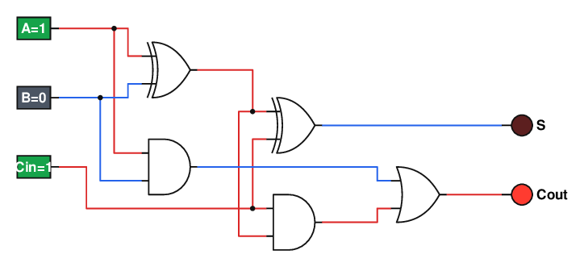
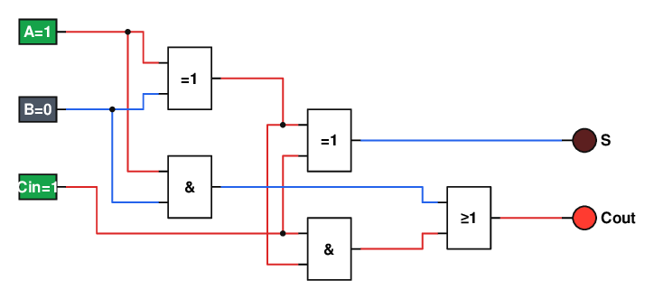
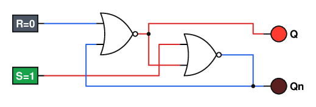

# Breadboard simulator: design

*How to use the simulator is in [USER_GUIDE.md](USER_GUIDE.md); this document is about how it works.*

Builds on `notes.md`: a `Gate` class holding a predicate function, and a graph of
nodes that is evaluated to simulate the circuit. The fixes from the review are
built in: gates can take any number of inputs, nodes know their inputs, the
evaluation order is safe, there are input and output nodes, feedback loops work,
wires are modelled as nets with 0/1/Z/X values, and a breadboard layer sits on top.

Later additions:

- typing Boolean expressions such as `F = A + B·C'`, which are evaluated as a
  circuit and can be laid out on the breadboard automatically (§6)
- a truth table for the selected gate (§4.4)
- a window that scales and makes better use of the screen (§4.1–4.2)
- a schematic mode: the circuit drawn with gate symbols (*portsymboler*), which
  can also be used to design circuits (§7)

---

## 1. Overview

Three layers, each only talking to the one below it. The netlist (§6.5) sits
between the UI and the two lower layers. Expressions, schematics and the
breadboard all convert to and from it, so they are three views of one circuit:

```
┌──────────────────────────────────────────────┐
│ 3. UI            tkinter, scales with the    │  breadboard or schematic view, truth
│                  window                      │  tables, expression editor
├──────────────────────────────────────────────┤
│    Netlist       expressions and schematics  │  one circuit, three views: text (§6),
│                  convert to and from it      │  gate symbols (§7), breadboard (§6.7)
├──────────────────────────────────────────────┤
│ 2. Breadboard    holes, strips, wires, parts │  build(): physical layout → circuit
│                  chip pinouts                │
├──────────────────────────────────────────────┤
│ 1. Logic core    Logic, Gate, Net, Node,     │  settle(): propagate values until stable
│                  Circuit                     │
└──────────────────────────────────────────────┘
```

There are two kinds of change, handled differently:

| User action                           | What happens                                                      |
|---------------------------------------|-------------------------------------------------------------------|
| Place or remove a wire, chip, LED, …  | `Breadboard.build()` rebuilds the whole circuit (cheap), then `settle()` |
| Flip a logic switch                   | `Circuit.set_input()` re-evaluates only the affected nodes; no rebuild |
| Build an expression on the board      | `layout()` generates all the parts on a new `Breadboard` (§6.7)    |
| Edit the schematic                    | `to_netlist().to_circuit()` builds a new circuit, gate values carried over as in §3.6 (§7.8) |

Layer 1 can be built and tested on its own (e.g. a full adder in plain Python)
before any breadboard code exists.

---

## 2. Layer 1: logic core

### 2.1 Logic values

`bool` is not enough once real wires are involved:

```python
class Logic(Enum):
    ZERO = "0"
    ONE  = "1"
    Z    = "Z"   # floating: nothing drives this net
    X    = "X"   # unknown: conflicting drivers, undefined input, oscillation, power-up state
```

A gate input that is `Z` is treated the same as `X` (a floating CMOS input has
no defined value).

### 2.2 Gate (the class from your notes, fixed)

`Gate` stays a plain, concrete class holding a lambda. Each gate type is just
data, so it doesn't need to be abstract. The fixes: `self` is added,
`arity` (the number of inputs) is stored and checked, and inputs are
`Logic` values instead of `bool`.

To keep writing gates as simple `bool` lambdas, `evaluate` handles unknown
inputs itself: it tries every 0/1 combination for the unknown inputs and checks
whether the output depends on them.

```python
class Gate:
    def __init__(self, name: str, arity: int, expression: Callable[..., bool]):
        self.name = name
        self.arity = arity
        self._expression = expression

    def evaluate(self, *inputs: Logic) -> Logic:
        if len(inputs) != self.arity:
            raise ValueError(f"{self.name} takes {self.arity} inputs, got {len(inputs)}")
        unknown = [i for i, v in enumerate(inputs) if not v.known()]
        bits = [v is Logic.ONE for v in inputs]
        results = set()
        for guess in product((False, True), repeat=len(unknown)):
            for i, b in zip(unknown, guess):
                bits[i] = b
            results.add(bool(self._expression(*bits)))
            if len(results) > 1:
                return Logic.X          # output depends on the unknown input
        return Logic.of(results.pop())  # same answer whatever the unknowns are

AND  = Gate("AND",  2, lambda a, b: a and b)
OR   = Gate("OR",   2, lambda a, b: a or b)
NAND = Gate("NAND", 2, lambda a, b: not (a and b))
NOR  = Gate("NOR",  2, lambda a, b: not (a or b))
XOR  = Gate("XOR",  2, lambda a, b: a != b)
NOT  = Gate("NOT",  1, lambda a: not a)
AND3 = Gate("AND3", 3, lambda a, b, c: a and b and c)
```

This gives the right answers automatically: `AND(0, X) = 0`, `AND(1, X) = X`,
`OR(1, Z) = 1`, `NOT(X) = X`.

### 2.3 The graph: nets and nodes

This is the main change from the notes. On a breadboard, gates are not
connected directly to each other. They are connected through **nets**: groups
of points that are electrically the same wire. One output can feed many inputs,
and two outputs can (wrongly) end up on the same net. So the graph has two
kinds of objects:

- **Node**: a component that reads nets and drives at most one net.
- **Net**: a wire. It knows which nodes drive it and which nodes read it.

```
 InputNode A ──▶ net a ──┬──▶ GateNode XOR ──▶ net s ──▶ LedNode
 InputNode B ──▶ net b ──┼──▶ GateNode XOR
                         └──▶ GateNode AND ──▶ net c ──▶ LedNode
```

```python
class Net:
    def __init__(self, name: str):
        self.name = name
        self.drivers: list[Node] = []   # nodes whose output is this net
        self.readers: list[Node] = []   # nodes that have this net as an input
        self.value = Logic.Z
        self.strong = False             # driven by a real output (not only via a resistor)
        self.short = False              # strong drivers disagree (0 and 1)
```

`Node` is where the **abstract class** from your notes belongs. Different kinds
of node compute their value in different ways:

```python
class Node(ABC):
    strong = True   # a "weak" driver loses to a strong one (see resistors)

    def __init__(self, name: str, inputs: list[Net], output: Net | None):
        self.name = name
        self.inputs = inputs            # ordered: input pin i reads inputs[i]
        self.output = output
        self.value = Logic.X            # last computed output
        for net in inputs:
            net.readers.append(self)    # wiring both directions, once, here
        if output is not None:
            output.drivers.append(self)

    @abstractmethod
    def compute(self) -> Logic: ...
```

| Node kind      | Inputs                      | Output        | `compute()`                                                |
|----------------|-----------------------------|---------------|------------------------------------------------------------|
| `GateNode`     | data nets + (VCC, GND)      | 1 net         | `Z` if unpowered, otherwise `gate.evaluate(*data values)`  |
| `InputNode`    | none                        | 1 net         | its current setting (logic switch, or the power supply's 1/0) |
| `LedNode`      | anode, cathode              | none          | `ONE` if anode=1 and cathode=0, `X` if either is X, else `ZERO` |
| `ResistorHalf` | 1 net                       | 1 net (weak)  | source net's value if it is strongly driven, otherwise `Z` |

`GateNode` lists the chip's VCC and GND nets as extra inputs. That way, adding
the power wire automatically re-evaluates the gate, so "I forgot to power the
chip" just works.

```python
class GateNode(Node):
    def __init__(self, name, gate: Gate, inputs: list[Net], output: Net,
                 power: tuple[Net, Net] | None = None):   # None = always powered
        self.gate = gate
        self.data = inputs
        self.power = power
        super().__init__(name, inputs + list(power or ()), output)

    def compute(self) -> Logic:
        if self.power is not None:
            vcc, gnd = self.power
            if vcc.value is not Logic.ONE or gnd.value is not Logic.ZERO:
                return Logic.Z
        return self.gate.evaluate(*(net.value for net in self.data))
```

### 2.4 Net resolution

A net's value is computed from its drivers. Strong drivers win over weak
ones, and drivers that disagree give `X`:

```python
def resolve(self) -> bool:                  # method on Net; True if value or strength changed
    old = (self.value, self.strong)
    strong = [d.value for d in self.drivers if d.strong and d.value is not Logic.Z]
    weak   = [d.value for d in self.drivers if not d.strong and d.value is not Logic.Z]
    self.short = Logic.ONE in strong and Logic.ZERO in strong
    if strong:
        self.value, self.strong = combine(strong), True
    elif weak:
        self.value, self.strong = combine(weak), False
    else:
        self.value, self.strong = Logic.Z, False
    return (self.value, self.strong) != old

def combine(values: list[Logic]) -> Logic:
    distinct = set(values)
    return distinct.pop() if len(distinct) == 1 else Logic.X
```

| Drivers on the net                     | Result                    |
|----------------------------------------|---------------------------|
| none                                   | `Z` (floating)            |
| one output = 1                         | `1`                       |
| two outputs, 1 and 1                   | `1`                       |
| two outputs, 1 and 0 (e.g. VCC to GND) | `X`, and `short = True`   |
| only a resistor to GND                 | `0` (weak)                |
| a resistor to GND **and** an output = 1 | `1` (strong wins)        |

### 2.5 Simulation: event-driven `settle()`

The review recommended topological sort for circuits without loops, and
"repeat until stable" for circuits with feedback. A **worklist** algorithm does
both in one loop:

1. Put the nodes to evaluate in a queue.
2. Take a node off the queue and compute its new value. If the value changed,
   re-resolve its output net. If the net changed, add every reader of that net
   to the queue.
3. Stop when the queue is empty (the circuit is stable).

```python
def settle(self, start: Iterable[Node] | None = None, limit: int = 100) -> None:
    if start is None:                       # full evaluation after a (re)build
        for net in self.nets:
            net.resolve()
        start = self.topological_order()
    queue = deque(start)
    queued = set(queue)
    evals: Counter[Node] = Counter()
    while queue:
        node = queue.popleft()
        queued.discard(node)
        evals[node] += 1
        new = node.compute()
        if evals[node] > limit:             # still changing: it's oscillating
            new = Logic.X
            self.oscillating.add(node)
        if new is node.value:
            continue
        node.value = new
        if node.output is not None and node.output.resolve():
            for reader in node.output.readers:
                if reader not in queued:
                    queued.add(reader)
                    queue.append(reader)
    # stays reported until something drives it to a known value again
    self.oscillating = {node for node in self.oscillating if node.value is Logic.X}

def set_input(self, node: InputNode, value: Logic) -> None:
    node.setting = value
    self.settle([node])                     # only what depends on this switch is recomputed
```

Why this works:

- **Loop-free circuits:** whatever the order, the result is correct.
  Topological order is just an optimization. With the queue seeded in
  topological order (Kahn's algorithm: repeatedly take a node whose inputs are
  all done), every node is evaluated exactly once.
  `topological_order()` puts nodes that are part of a loop last.
- **Latches:** node values are **kept between calls**. That is the memory: after
  setting S=1 and then S=0, an SR latch built from NOR gates still has Q=1. A
  freshly built latch with S=R=0 has Q=`X`, the honest answer for a power-up state.
- **Oscillation:** a NAND gate plus two inverters in a ring (three inversions)
  never settles. When a node has been evaluated more than `limit` times, its
  output is forced to `X`. `X` passes through inverters unchanged, so the ring
  becomes stable at `X` and the node is reported in `circuit.oscillating`.
  It stays reported, even across unrelated switch flips and rebuilds, until
  something drives it to a known value again (e.g. the ring is disabled).
- **Switch flips are cheap:** only the parts of the circuit that depend on the
  switch are re-evaluated.

This is a zero-delay simulation: a gate's output changes immediately when its
inputs do, with no propagation delay. That is fine for this course. See
§9 for what it can't model.

---

## 3. Layer 2: breadboard

### 3.1 Geometry and hole names

A half-size board has 30 columns, with rows `a`–`e` above the centre channel,
`f`–`j` below it, and two power rails at the top and bottom.

```
T+  ● ● ● ● ● ● ● ● ● ● ●  …     each rail is one connected strip
T-  ● ● ● ● ● ● ● ● ● ● ●  …
     1 2 3 4 5 6 7 8 9 …
 a   ● ● ● ● ● ● ● ● ● …      ┐
 b   ● ● ● ● ● ● ● ● ● …      │ in each column, a–e is one strip
 c   ● ● ● ● ● ● ● ● ● …      │ (e.g. a5 b5 c5 d5 e5)
 d   ● ● ● ● ● ● ● ● ● …      │
 e   ● ● ● ● ● ● ● ● ● …      ┘
     ──────── channel ────────
 f   ● ● ● ● ● ● ● ● ● …      ┐
 …                            │ f–j is a separate strip
 j   ● ● ● ● ● ● ● ● ● …      ┘
B+  ● ● ● ● ● ● ● ● ● ● ●  …
B-  ● ● ● ● ● ● ● ● ● ● ●  …
```

Holes are strings: `"a5"`, `"j30"`, `"T+3"`, `"B-12"`. Holes in the same strip
always share a net, so the simulator works with **strips**, not holes:

```python
RAILS = ("T+", "T-", "B+", "B-")

def strip_of(hole: str) -> str:
    if hole[:2] in RAILS:
        return hole[:2]                                    # "T+3"  -> "T+"
    row, col = hole[0], int(hole[1:])
    return f"{'top' if row in 'abcde' else 'bot'}{col}"    # "c5"   -> "top5"
```

### 3.2 Strips to nets with union-find

Each wire joins two strips. Union-find on strip names merges them into nets:

```python
uf = UnionFind()
for wire in wires:
    uf.union(strip_of(wire.a), strip_of(wire.b))
# net of any hole = uf.find(strip_of(hole))
```

The rails are not connected to anything automatically. The power supply goes
in the top rails, and the bottom rails need wires, just like on a real board.

### 3.3 Parts

Every physical thing placed on the board is a `Part`. It reports which holes
its pins occupy (`pins()`), and when the board is built it creates its nodes
(`instantiate()`):

```python
class Part(ABC):
    @abstractmethod
    def pins(self) -> dict[str, str]: ...            # pin name -> hole

    def instantiate(self, circuit: Circuit, net_of: Callable[[str], Net]) -> list[Node]:
        return []                                    # wires create no nodes
```

| Part                  | Pins                    | Creates                                         |
|-----------------------|-------------------------|-------------------------------------------------|
| `Wire(a, b)`          | 2                       | nothing; it is used by the union-find step      |
| `PowerSupply(+, -)`   | 2 (normally `T+`, `T-`) | two `InputNode`s fixed at 1 and 0               |
| `LogicInput(hole, label="")`    | 1             | one `InputNode` (a switch the user flips)       |
| `Led(anode, cathode, label="")` | 2             | one `LedNode`                                   |
| `Resistor(a, b)`      | 2                       | two `ResistorHalf`s, a→b and b→a (weak)         |
| `Chip(spec, column)`  | 14                      | one `GateNode` per gate in the spec             |

**Resistors** are included so a normal LED circuit works (LED cathode → resistor →
GND). A resistor half only passes on a value from a *strongly* driven net, and
the value it drives is weak. That stops the two halves feeding a value back and
forth between themselves, and lets a real output win over a pull-up or pull-down.
Current is not modelled, so an LED wired straight into the GND rail also works.

**Labels.** Switches and LEDs take an optional `label` (e.g. `"A"`, `"Cout"`)
that the UI draws next to them. Without labels, a generated layout (§6.7) has no
way of showing which switch is which input.

**Board size.** `Breadboard.resize(columns)` changes the number of columns,
e.g. between a half-size (30) and a full-size (63) board. It raises
`ValueError` and changes nothing if a part would end up off the board, and
otherwise sets `columns` and calls `build()`.

**Stable ids.** `place()` gives every part a `uid` from a counter on the board,
and the uid is saved with the board. The schematic of a board (§7.6) names its
symbols after these uids, which is how symbol positions and names survive
rebuilds.

### 3.4 Chips are data

A chip spec lists its gates and which pins they use, so adding a chip
means adding one entry. Most quad 2-input chips share the same pinout:

```python
@dataclass(frozen=True)
class ChipSpec:
    name: str
    vcc: int
    gnd: int
    gates: tuple[tuple[Gate, tuple[int, ...], int], ...]   # (gate, input pins, output pin)
    pin_count: int = 14
    # __post_init__: check len(input pins) == gate.arity for every gate

def quad_2in(name, gate):            # 7400 / 7408 / 7432 / 7486
    return ChipSpec(name, vcc=14, gnd=7, gates=(
        (gate, (1, 2), 3), (gate, (4, 5), 6), (gate, (9, 10), 8), (gate, (12, 13), 11)))

CHIPS = {
    "7400": quad_2in("74HC00", NAND),
    "7408": quad_2in("74HC08", AND),
    "7432": quad_2in("74HC32", OR),
    "7486": quad_2in("74HC86", XOR),
    "7402": ChipSpec("74HC02", vcc=14, gnd=7, gates=(      # NOR: output pin comes first
        (NOR, (2, 3), 1), (NOR, (5, 6), 4), (NOR, (8, 9), 10), (NOR, (11, 12), 13))),
    "7404": ChipSpec("74HC04", vcc=14, gnd=7, gates=(      # hex inverter
        (NOT, (1,), 2), (NOT, (3,), 4), (NOT, (5,), 6),
        (NOT, (9,), 8), (NOT, (11,), 10), (NOT, (13,), 12))),
}
```

A chip sits across the channel with its notch to the left. If it is placed at
`column`, pin 1 is in hole `f{column}`:

```
        e5  e6  e7  e8  e9  e10 e11
        14  13  12  11  10   9   8
       ┌───────────────────────────┐
       ◖  74HC08                   │
       └───────────────────────────┘
         1   2   3   4   5   6   7
        f5  f6  f7  f8  f9  f10 f11
```

```python
def pin_hole(self, pin: int) -> str:        # method on Chip
    half = self.spec.pin_count // 2
    if pin <= half:
        return f"f{self.column + pin - 1}"
    return f"e{self.column + self.spec.pin_count - pin}"

def instantiate(self, circuit, net_of):
    net = lambda pin: net_of(self.pin_hole(pin))
    power = (net(self.spec.vcc), net(self.spec.gnd))
    return [circuit.add(GateNode(f"{self.spec.name}@{self.column}.{i}", gate,
                                 [net(p) for p in ins], net(out), power))
            for i, (gate, ins, out) in enumerate(self.spec.gates)]
```

Because the chip occupies both rows `e` and `f`, each of its 14 pins gets its
own strip, which is why chips straddle the channel on a real board too.

### 3.5 `Breadboard.build()`

```python
def build(self) -> None:
    uf = UnionFind()
    for part in self.parts:
        if isinstance(part, Wire):
            uf.union(strip_of(part.a), strip_of(part.b))
    circuit = Circuit()
    nets: dict[str, Net] = {}

    def net_of(hole: str) -> Net:               # one Net object per union-find root
        root = uf.find(strip_of(hole))
        if root not in nets:
            nets[root] = circuit.net(root)
        return nets[root]

    old, old_oscillating = self.nodes, self.circuit.oscillating
    self.nodes = {}
    for part in self.parts:
        new = part.instantiate(circuit, net_of)
        for prev, node in zip(old.get(part, []), new):
            node.value = prev.value             # see 3.6
            if prev in old_oscillating:
                circuit.oscillating.add(node)
        self.nodes[part] = new
    circuit.settle()
    self.circuit, self._uf, self._nets = circuit, uf, nets   # kept for net_at(hole)
```

`place(part)` checks that every pin is a real hole and not already taken, adds
the part and calls `build()`. `remove(part)` does the reverse. Flipping a switch
(`toggle` / `set`) calls `circuit.set_input()` directly, without a rebuild.

### 3.6 Keeping state when rewiring

Rebuilding creates new nodes, which would reset every latch to `X` each time a
wire is added. That isn't what a real circuit does. The fix is the two
lines marked above: each part's new nodes start with the values its old nodes
had, and `settle()` takes it from there. A latch that held Q=1 still holds Q=1
after an unrelated LED is plugged in.

### 3.7 Diagnostics

A simulator for learning is most useful when it explains *why* an LED is off.
`Breadboard.diagnose() -> list[str]` checks:

- **Short circuit:** a net with `short = True` (e.g. a wire from `T+` to `T-`).
- **Unpowered chip:** the VCC pin's net is not 1, or the GND pin's net is not 0.
- **Floating input:** a gate input net is `Z`. Only reported for gates whose output
  is actually used, otherwise every unused gate on a chip would be flagged.
- **Oscillation:** the nodes in `circuit.oscillating`.

---

## 4. Layer 3: UI

The model knows nothing about the UI. A Python script or the REPL is enough to
test everything (§5). The tkinter front end is for using it: click two holes to
add a wire, pick a chip and click a column to place it, click a switch to flip
it. LEDs are drawn as coloured circles (on / off / `X`), and holes, chip legs
and wires are coloured by the value on their net. Saving and loading boards as
JSON (a list of parts with their holes) is still optional.

### 4.1 Window layout

The first version draws holes 24 px apart, with a column of tools on the left
and a panel on the right. On a 3072×1920 screen with Tk scaling 2.67, the board
covers about a quarter of the screen width, while the widgets around it are
sized in points and come out large. The new layout gives the board all the space
the controls don't need:

```
┌──────────────────────────────────────────────────────────────────────────────┐
│ [Wire] [Chip] 7408 AND ▾ [Input] [LED] [Resistor] [Power] [Delete] │ Half ▾  │  toolbar
├─────────────────────────────────────────────────┬────────────────────────────┤
│                                                 │ Problems (1) │ Gate │ Expr.│
│                                                 │────────────────────────────│
│                                                 │                            │
│                breadboard canvas                │      selected tab          │
│      fills its pane, keeps its proportions      │                            │
│                                                 │                            │
│                                                 │                            │
├─────────────────────────────────────────────────┴────────────────────────────┤
│ Click two holes to connect them.     ● 1  ● 0  ● X  ● Z     h5: bot5 = 1     │  status bar
└──────────────────────────────────────────────────────────────────────────────┘
```

- **A toolbar across the top** replaces the column of tools. The tools are
  `ttk.Radiobutton`s with `style="Toolbutton"`, so they look like toggle
  buttons, with keyboard shortcuts W, C, I, L, R, P and D (Esc cancels). The
  chip menu sits next to the Chip tool. The board-size menu (Half: 30 columns,
  Full: 63) calls `Breadboard.resize()` and shows its error in the status bar
  if parts would fall off the board.
- **The board and side panel share a horizontal `ttk.Panedwindow`**, so the
  divider can be dragged. F9 hides and shows the side panel, giving the board the
  full width.
- **The side panel is a `ttk.Notebook`** with three tabs instead of stacked
  boxes: *Problems*, *Gate* (§4.4) and *Expression* (§6.8). The Problems tab
  title includes the count, e.g. "Problems (2)", so problems are noticed even
  while another tab is open.
- **A status bar** holds the current tool's help text (red for errors), the
  colour legend, and what's under the mouse (hole, net and value). These used
  to take room in the side panel.
- **Start size:** the window opens at 80 % of the screen (`winfo_screenwidth()`,
  `winfo_screenheight()`), centred, with a minimum size of 40 % so the toolbar
  always fits.

### 4.2 Scaling with the window

All board geometry moves out of the app into a class with no tkinter in it, so
it can be unit-tested:

```python
class BoardGeometry:
    def __init__(self, columns: int, width: float, height: float, min_pitch: float):
        self.columns = columns
        span_x = columns + 1                             # one pitch of board edge on each side
        span_y = max(ROW_SLOTS.values()) + 2
        self.pitch = max(min_pitch, min(width / span_x, height / span_y))
        self.board_width, self.board_height = span_x * self.pitch, span_y * self.pitch
        self.left = max(0.0, (width - self.board_width) / 2)   # centred when it fits
        self.top = max(0.0, (height - self.board_height) / 2)

    def hole_xy(self, hole: str) -> tuple[float, float]:
        row, column = parse_hole(hole)
        return self.left + column * self.pitch, self.top + (ROW_SLOTS[row] + 1) * self.pitch

    def hole_at(self, x: float, y: float) -> str | None:
        column = round((x - self.left) / self.pitch)
        row = SLOT_ROWS.get(round((y - self.top) / self.pitch) - 1)
        if row is None or not 1 <= column <= self.columns:
            return None
        hx, hy = self.hole_xy(f"{row}{column}")
        if (x - hx) ** 2 + (y - hy) ** 2 > (self.pitch / 2) ** 2:
            return None                                  # between holes
        return f"{row}{column}"
```

`ROW_SLOTS` and `SLOT_ROWS` are the row-to-slot tables from the current `ui.py`.

- **Fill the pane.** The canvas sits in a grid cell with `sticky="nsew"` and
  weight 1, so it grows with the window. On `<Configure>` (the canvas changed
  size) the app makes a new `BoardGeometry` from `canvas.winfo_width()` and
  `winfo_height()` and redraws. The board keeps its proportions and is centred.
- **Debounce the redraw.** Dragging a window edge fires dozens of `<Configure>`
  events. Each one cancels the pending redraw (`after_cancel`) and schedules a
  new one (`after_idle`), so only the final size gets drawn.
- **Every size is a fraction of the pitch**, so the drawing scales as a whole:

  | Thing                       | Size                              |
  |-----------------------------|-----------------------------------|
  | hole radius                 | 0.21 × pitch                      |
  | wire width                  | 0.17 × pitch                      |
  | LED body radius             | 0.33 × pitch                      |
  | switch, half width          | 0.38 × pitch                      |
  | chip leg, half width        | 0.17 × pitch                      |
  | canvas text                 | `-round(0.33 × pitch)`            |

  Canvas fonts use negative sizes, which mean pixels. Point sizes would follow
  `tk scaling` but not the window size.
- **A minimum pitch, then scrollbars.** The pitch never drops below 8 points
  (`8 × tk scaling` pixels, about 21 px on this screen). A board that doesn't
  fit at that size, such as a 56-column expression layout in a small window
  (§6.7), gets scrollbars, with `scrollregion` set to the board size. Hit testing
  already converts event coordinates with `canvasx`/`canvasy`, so clicks keep
  working while scrolled.
- **HiDPI widgets.** ttk fonts are in points and follow `tk scaling`, with one
  exception that matters here: `ttk.Treeview` row height. Tk 9.0 (on this
  machine) sizes rows from the font, but Tk 8.6, which many Python installs
  still ship, uses a fixed 20 px and clips the truth table rows. So always set
  it: `style.configure("Treeview", rowheight=font.nametofont("TkDefaultFont").metrics("linespace") + 4)`.
- **Readable wires.** Wires are coloured by their net's value (red 1, blue 0,
  amber X, grey Z), like the holes, so a signal can be followed by eye. Each
  wire is drawn as a slight curve (`smooth=True` through its midpoint, pushed
  sideways by 0.12 × its length, at most 1.5 × pitch), so a wire along a row
  doesn't cover the holes under it. Chip names are drawn last, so wires never
  hide them.

### 4.3 Selecting a gate

Clicking a chip pin is currently an error ("hole already in use"). With any tool
except Delete, it now selects:

- **A data pin** selects the gate it belongs to. Its input legs get an outline
  in one colour, its output leg in another, and the Gate tab opens.
- **Pin 7 (GND) or 14 (VCC)** selects the whole chip, and the Gate tab shows the
  chip's pinout (pin number to name) instead.
- **Esc** clears the selection, and so does removing the chip. The selection is
  stored as `(chip, gate index)`. Parts survive rebuilds (§3.6), so the
  selection does too.

This needs two helpers in `chips.py`:

```python
def pin_names(self) -> dict[int, str]:          # method on ChipSpec
    names = {self.vcc: "VCC", self.gnd: "GND"}
    for n, (_, inputs, output) in enumerate(self.gates, start=1):
        for letter, pin in zip("ABCD", inputs):
            names[pin] = f"{n}{letter}"
        names[output] = f"{n}Y"
    return names

def gate_at(self, pin: int) -> int | None:      # which gate a pin belongs to
    for i, (_, inputs, output) in enumerate(self.gates):
        if pin == output or pin in inputs:
            return i
    return None
```

These produce the datasheet names: on the 74HC00, pins 1, 2 and 3 are 1A, 1B and
1Y. On the 74HC02 pin 1 is 1Y (the output comes first), and on the 74HC04 pins 1
and 2 are 1A and 1Y.

### 4.4 Truth table of the selected gate

The Gate tab:

```
 Show: [ 74HC08 at column 15, gate 1 ▾ ]        (or AND, OR, NAND, NOR, XOR, NOT, AND3)

    1A (pin 1)   1B (pin 2) │ 1Y (pin 3)
        0            0      │     0
        0            1      │     0
        1            0      │     0
 ▶      1            1      │     1          ← matches the current inputs

 Now: 1A = 1, 1B = 1 → 1Y = 1
```

- **The rows come from the gate itself**, so they are right for any gate,
  including ones added later:

  ```python
  def truth_table(gate: Gate) -> list[tuple[tuple[Logic, ...], Logic]]:   # in logic.py
      return [(values, gate.evaluate(*values))
              for values in product((Logic.ZERO, Logic.ONE), repeat=gate.arity)]
  ```

- **Live values:** on every redraw the tab reads the selected gate's input nets.
  If they are all 0 or 1, the matching row is highlighted. The "Now" line always
  shows the actual values, X and Z included, so a floating input shows up as
  `1B = Z → 1Y = X`.
- **The Show menu also lists the gate library**, so a gate's table can be looked
  up without placing a chip. Selecting a gate on the board switches the menu to
  that gate.
- **A shared `TruthTableView` widget** displays the table: a `ttk.Treeview`
  with one column per input and output and a narrow separator column, and a
  `show(columns, rows, highlight=None)` method. The Expression tab (§6.8) uses
  the same widget.

---

## 5. Worked example: half adder

7486 (XOR) at column 5 gives the sum, and 7408 (AND) at column 15 gives the carry.

```python
bb = Breadboard()
bb.place(PowerSupply("T+1", "T-1"))
bb.place(Wire("T+3", "B+1"))                 # feed the bottom rails
bb.place(Wire("T-3", "B-1"))

bb.place(Chip(CHIPS["7486"], 5))
bb.place(Wire("a5", "T+2"))                  # pin 14 (e5) -> VCC
bb.place(Wire("j11", "B-2"))                 # pin 7 (f11) -> GND
bb.place(Chip(CHIPS["7408"], 15))
bb.place(Wire("a15", "T+5"))
bb.place(Wire("j21", "B-6"))

A = bb.place(LogicInput("j5"))               # XOR pin 1
B = bb.place(LogicInput("j6"))               # XOR pin 2
bb.place(Wire("h5", "h15"))                  # A -> AND pin 1
bb.place(Wire("h6", "h16"))                  # B -> AND pin 2

s = bb.place(Led("g7", "B-5"))               # XOR pin 3; cathode straight to GND
bb.place(Wire("g17", "g25"))                 # AND pin 3, moved to free space
c = bb.place(Led("h25", "h26"))
bb.place(Resistor("i26", "B-8"))             # LED -> resistor -> GND

bb.set(A, Logic.ONE); bb.set(B, Logic.ONE)
bb.led(s), bb.led(c)                         # -> (ZERO, ONE)
bb.diagnose()                                # -> []
```

Leaving out `Wire("a15", "T+5")` should give carry LED = off, and
`diagnose()` → `["74HC08 at column 15 is not powered"]`.

---

## 6. Boolean expressions

You type an expression such as `F = A + B·C'` and the simulator turns it into a
circuit. The text is parsed into a tree and compiled to a netlist of gates. The
netlist is then either simulated by layer 1 to get the truth table, or laid out
on the breadboard with real chips, wires, switches and LEDs.

```
"F = A + BC'" ─tokenize─▶ tokens ─parse─▶ Program (tree) ─compile─▶ Netlist
                                                                       │
                                   ┌───────────────────────────────────┴──────┐
                                   ▼                                          ▼
                          to_circuit(): Circuit                   layout(): Breadboard
                          truth table by simulation               chips, wires, switches, LEDs
```

### 6.1 What you can type

| Meaning   | Type                               | Examples                 |
|-----------|------------------------------------|--------------------------|
| OR        | `+` `\|` `∨`                       | `A + B`                  |
| AND       | `·` `*` `&` `∧`, or nothing        | `A·B`, `AB`, `A(B + C)`  |
| XOR       | `⊕` `^`                            | `A ⊕ B`                  |
| NOT       | `'` after, or `¬` `!` `~` before   | `A'`, `(AB)'`, `¬A`      |
| constants | `0` `1`                            | `A·1`                    |
| grouping  | `(` `)`                            | `(A + B)'`               |

- **Precedence**, from tightest to loosest: NOT, AND, XOR, OR. So `A + BC'` is
  `A + (B·(C'))`, and `AB ⊕ C` is `(A·B) ⊕ C`. Operators at the same level group
  from the left. The course writes NOT as a bar over the letters; `A'` and
  `(AB)'` are the keyboard version.
- **Names** start with a capital letter, followed by lowercase letters, digits
  or `_`: `A`, `B`, `Cin`, `X1`. That rule is what makes AND-without-an-operator
  work: `AB` is `A·B`, while `Cin` is one name.
- **Several equations** go one per line or are separated by `;`. An equation
  without `Name =` is called `F`.
- **Names defined by an equation can be used in the others**, in any order.
  Every other name is an input. Feedback is allowed, so an SR latch can be typed
  in directly:

```
S = A ⊕ B ⊕ Cin            full adder
Cout = AB + Cin(A ⊕ B)

Q  = (R + Qn)'             SR latch from two NOR gates
Qn = (S + Q)'
```

### 6.2 Grammar

```
program  = equation { (";" | newline) equation }       empty lines are skipped
equation = [ NAME "=" ] or
or       = xor { ("+" | "|" | "∨") xor }
xor      = and { ("⊕" | "^") and }
and      = unary { [ "·" | "*" | "&" | "∧" ] unary }    no operator also means AND
unary    = ("¬" | "!" | "~") unary | atom { "'" }
atom     = NAME | "0" | "1" | "(" or ")"
NAME     = capital letter { lowercase letter | digit | "_" }
```

Each rule handles one precedence level and calls the next tighter one. That is
the whole idea behind a recursive-descent parser: precedence comes from which
rule calls which.

### 6.3 Parsing

**The tokenizer** uses a symbol table that maps every accepted spelling to one
token kind, so the parser never sees the alternatives:

```python
SYMBOLS = {
    "+": "OR", "|": "OR", "∨": "OR",
    "⊕": "XOR", "^": "XOR",
    "·": "AND", "⋅": "AND", "∙": "AND", "*": "AND", "&": "AND", "∧": "AND",
    "¬": "NOT", "!": "NOT", "~": "NOT",
    "'": "PRIME", "’": "PRIME",
    "(": "(", ")": ")", "=": "=", ";": "SEP", "\n": "SEP",
}
NAME = re.compile(r"[A-Z][a-z0-9_]*")
```

There are three AND dots because `·` (middle dot), `⋅` (dot operator) and `∙`
(bullet operator) look the same but are different characters, and text copied
from slides or PDFs can contain any of them. The curly `’` is there for text
copied from a word processor. Spaces are skipped, `0` and `1` become `CONST`
tokens, and anything else is an error. Every token keeps its position in the
text, for error messages.

**The parser** has one method per grammar rule, each with a `peek()`/`take()`
over the tokens. The AND level is the only unusual one: if the next token can
start an operand, it is an AND without an operator.

```python
ATOM_START = {"NAME", "CONST", "(", "NOT"}

def and_(self) -> Expr:
    left = self.unary()
    while self.peek().kind == "AND" or self.peek().kind in ATOM_START:
        if self.peek().kind == "AND":
            self.take()
        left = Op(AND, (left, self.unary()))
    return left

def unary(self) -> Expr:
    if self.peek().kind == "NOT":
        self.take()
        return Op(NOT, (self.unary(),))
    node = self.atom()
    while self.peek().kind == "PRIME":       # A'' is NOT(NOT(A))
        self.take()
        node = Op(NOT, (node,))
    return node
```

`or_` and `xor` use the same loop with their own operator and without the
juxtaposition rule. An equation starts with `NAME =` when the first two tokens
are a name and `=`. Otherwise it is an unnamed expression, called `F`.

**Errors** are `ParseError(ValueError)` with a message and a position, so the UI
can mark the exact character:

| Input          | Message                                                      | Marks        |
|----------------|--------------------------------------------------------------|--------------|
| `A +`          | expected a name, 0, 1 or '(', found end of input             | the end      |
| `A + * B`      | expected a name, 0, 1 or '(', found '*'                      | `*`          |
| `(A + B`       | expected ')', found end of input                             | the end      |
| `A + B)`       | expected an operator or the end of the equation, found ')'   | `)`          |
| `a + b`        | names start with a capital letter, not 'a'                   | `a`          |
| `F = A; F = B` | F is defined twice                                           | the second F |

### 6.4 The expression tree

The tree reuses the gate objects from §2.2, i.e. the `Gate` class from your
notes, so a parsed expression already knows how to evaluate itself:

```python
@dataclass(frozen=True)
class Var:
    name: str

@dataclass(frozen=True)
class Const:
    value: Logic

@dataclass(frozen=True)
class Op:
    gate: Gate                      # AND, OR, XOR or NOT from logic.py
    args: tuple[Expr, ...]

Expr = Var | Const | Op

@dataclass(frozen=True)
class Equation:
    name: str
    expr: Expr
    position: int                   # for error messages

@dataclass(frozen=True)
class Program:
    equations: tuple[Equation, ...]
    # outputs: the equation names, in order
    # inputs:  every other name used, in natural order (X2 before X10)
```

Two small functions work on the tree:

- **`to_text(expr)`** prints it fully parenthesised with the standard symbols,
  e.g. `(A + (B · C'))`. This shows the user how the parser read their
  expression, and it parses back to the same tree, which makes a good test.
- **`evaluate(expr, env)`** evaluates the tree directly with `Gate.evaluate`.
  The UI doesn't use it. It is the reference the circuit simulation is tested
  against.

### 6.5 Compiling to a netlist

A netlist is the circuit as a flat list of gates connecting named signals. Both
the simulation and the breadboard layout start from it:

```python
BUF = Gate("BUF", 1, lambda a: a)            # in logic.py: "this output is that signal"

@dataclass(frozen=True)
class GateInstance:
    gate: Gate
    inputs: tuple[str, ...]                  # signal names
    output: str

@dataclass
class Netlist:
    inputs: list[str]
    outputs: list[str]
    gates: list[GateInstance]

    @staticmethod
    def from_program(program: Program) -> Netlist:
        netlist = Netlist(program.inputs, program.outputs, [])
        shared: dict[tuple, str] = {}

        def signal(expr: Expr) -> str:
            if isinstance(expr, Var):
                return expr.name
            if isinstance(expr, Const):
                return expr.value.value                 # "0" or "1"
            key = (expr.gate.name, tuple(signal(a) for a in expr.args))
            if key not in shared:                       # identical subexpressions share a gate
                shared[key] = f"n{len(shared) + 1}"
                netlist.gates.append(GateInstance(expr.gate, key[1], shared[key]))
            return shared[key]

        for eq in program.equations:
            netlist.gates.append(GateInstance(BUF, (signal(eq.expr),), eq.name))
        return netlist
```

- **Signal names:** inputs and outputs keep the user's names, internal signals
  are `n1`, `n2`, … (lowercase, so they can't clash with a user's name), and
  the constants are `"0"` and `"1"`.
- **Shared subexpressions:** in `S = A ⊕ B ⊕ Cin; Cout = AB + Cin(A ⊕ B)`,
  `A ⊕ B` becomes one XOR gate, not two.
- **Every equation ends in a BUF** that drives a signal named after the
  equation. That is why the order of equations doesn't matter and why feedback
  works: `Q = (R + Qn)'` can use the signal `Qn` before Qn's equation has been
  compiled. It also handles `F = A` and `F = 1`, which have no gate of their
  own. A BUF costs nothing on the board, because the layout turns it into "the
  same net" (§6.7).
- **NOT folds into NAND and NOR.** The parser has no NAND or NOR operator, so
  `(R + Qn)'` compiles to an OR gate followed by a NOT. `Netlist.fused()`
  replaces each NOT whose input is an AND or OR gate used nowhere else with one
  NAND or NOR gate. The truth table doesn't change, but the circuit becomes what
  you would draw or build: the SR latch is two NOR gates, i.e. one 74HC02
  instead of a 74HC32 plus a 74HC04 (7 wires instead of 11). The schematic
  (§7.4) and the breadboard layout (§6.7) both start from the fused netlist.

  ```python
  def fused(self) -> Netlist:
      users = Counter(s for g in self.gates for s in g.inputs)
      driver = {g.output: g for g in self.gates}
      gates, removed = [], set()
      for g in self.gates:
          inner = driver.get(g.inputs[0]) if g.gate is NOT else None
          if inner is not None and inner.gate.name in ("AND", "OR") and users[inner.output] == 1:
              gates.append(GateInstance(NAND if inner.gate is AND else NOR, inner.inputs, g.output))
              removed.add(inner.output)
          else:
              gates.append(g)
      return Netlist(self.inputs, self.outputs, [g for g in gates if g.output not in removed])
  ```

### 6.6 Evaluating as a circuit

`to_circuit()` turns the netlist into a layer 1 `Circuit`: one `Net` per signal,
an `InputNode` per input and per constant, and a `GateNode` per gate. The truth
table is then produced by simulating that circuit:

```python
def to_circuit(self) -> tuple[Circuit, dict[str, InputNode], dict[str, Net]]:
    circuit = Circuit()
    nets: dict[str, Net] = {}

    def net(name: str) -> Net:
        if name not in nets:
            nets[name] = circuit.net(name)
            if name in ("0", "1"):                     # constants are fixed inputs
                circuit.add(InputNode(name, nets[name], Logic(name)))
        return nets[name]

    inputs = {name: circuit.add(InputNode(name, net(name))) for name in self.inputs}
    for g in self.gates:
        circuit.add(GateNode(g.output, g.gate, [net(s) for s in g.inputs], net(g.output)))
    return circuit, inputs, nets

def truth_table(self) -> list[tuple[tuple[Logic, ...], tuple[Logic, ...]]]:
    if len(self.inputs) > MAX_INPUTS:                  # 8 inputs = 256 rows
        raise ValueError(f"too many inputs for a truth table ({len(self.inputs)} > {MAX_INPUTS})")
    rows = []
    for values in product((Logic.ZERO, Logic.ONE), repeat=len(self.inputs)):
        circuit, inputs, nets = self.to_circuit()      # fresh each row: power-up state
        for name, value in zip(self.inputs, values):
            inputs[name].setting = value
        circuit.settle()
        rows.append((values, tuple(nets[name].value for name in self.outputs)))
    return rows
```

- **It is evaluated as a circuit, not as Python.** The truth table comes out of
  the same `settle()` that runs the breadboard, so the table shows what the
  circuit does, X included for anything undefined.
- **Each row gets a fresh circuit**, so rows are independent. For combinational
  expressions that changes nothing. With feedback, each row starts from
  power-up, so outputs that depend on the previous state come out as X. For the
  SR latch, S=1 R=0 gives Q=1, while S=R=0 gives Q=X (hold).
  `has_feedback()` (a depth-first search for a cycle through the gates) lets the
  UI say so: "This circuit has feedback: X rows depend on the previous state.
  Build it on the board to try it." On the board the latch behaves as expected:
  flipping S and R gives X, then set, hold, reset, hold.

### 6.7 Building it on the breadboard

`layout(netlist)` returns a `Layout`: the `Breadboard`, its switches and LEDs
by name, and `gates`, which says which chip and gate each netlist gate ended up
on (used to share the selection between the views, §7.1). It places real chips
and wires them up the way you would by hand in the lab. It is the most involved
part, but each step is simple:

**1. BUFs become aliases.** A BUF's output is the same net as its input:
`F = A` just means "F's LED goes on A's net". `source(signal)` follows these
aliases to the real signal. A loop made only of aliases (`F = G; G = F`) is an
error, because there is no gate to build.

**2. Choose chips.** Each gate type maps to a chip: AND to 74HC08, OR to
74HC32, XOR to 74HC86, NOT to 74HC04, NAND to 74HC00 and NOR to 74HC02 (NAND
and NOR come from `fused()`, §6.5). A chip of a type is filled before another
one is started.
Chips go left to right, with one free column between them:

```
column:  1   2 ─────── 8   9   10 ────── 16  17  18 ────── 24  25  26 …
         ·   [  chip 1  ]  ·   [  chip 2  ]   ·   [  chip 3  ]   ·   ·
```

The free columns (`·`) provide free strips, top and bottom, for the switches
and for signals that need more room.

**3. Power.** The supply goes in T+1/T−1, a wire joins T−2 to B−2 so GND is on
both sides, and each chip gets a wire from its VCC pin's strip to T+ and from
its GND pin's strip to B−, at the nearest free rail hole.

**4. Holes are the scarce resource.** Each strip has 5 holes. A chip pin's strip
has 4 free, and so does a switch's strip. Before wiring, count each signal's
*demand*: one hole per gate input it feeds, plus one for an LED. A signal is
available on a list of strips. When its current strip is down to its last hole
and it still has more than one connection to make, that last hole gets a wire
to a fresh strip, which adds 4 more holes:

```python
def tap(signal: str, near: int) -> str:
    """A free hole on the signal's net, extending it onto a new strip when one fills up."""
    if signal in ("0", "1"):
        return take_rail("T+" if signal == "1" else "T-", near)
    strip = home[signal][-1]
    if sum(h not in used for h in holes_of(strip)) == 1 and demand[signal] > 1:
        extra = next(strips)                       # the next free strip
        add(Wire(take(strip), take(extra)))
        home[signal].append(extra)
        strip = extra
    demand[signal] -= 1
    return take(strip)
```

Because demand is counted up front, a strip never runs out. Constants need no
strips: 1 is any free hole on T+, and 0 any free hole on T−. `holes_of(strip)`
lists a strip's holes far end first (a→e on top, j→f at the bottom), so wires
use the holes away from the chip.

**5. Wire up.** Each input gets a switch, labelled with its name, on a fresh
free strip. Then every gate input pin gets
`Wire(tap(source(signal), column), a free hole in the pin's strip)`.

**6. LEDs.** Each output gets an LED, labelled with its name. The anode comes
from `tap()` and the cathode goes into the nearest GND rail (T− for the top
half, B− for the bottom).

**7. Board size.** `columns = max(30, the highest column used)`, so the board
grows to fit, and the UI scrolls when needed (§4.2).

Results from prototyping this, with the fused netlist:

| Expression                                                   | Chips                                         | Wires | Columns |
|--------------------------------------------------------------|-----------------------------------------------|-------|---------|
| `F = A + B`                                                  | 74HC32                                        | 5     | 30      |
| full adder (§6.1)                                            | 74HC86, 74HC08, 74HC32                        | 17    | 30      |
| SR latch (§6.1)                                              | 74HC02                                        | 7     | 30      |
| `F = A·A·A·A·A·A·A·A·A + A'` (A feeds 11 inputs)             | 2 × 74HC08, 74HC04, 74HC32                    | 30    | 32      |
| `F = (A⊕B)(C⊕D)(A⊕C)(B⊕D)(A⊕D) + (AB)'(CD)' + A'B'C'D'`      | 2 × 74HC86, 2 × 74HC08, 74HC00, 74HC32, 74HC04 | 55    | 56      |

To test a layout, set the board's switches for every row of the netlist's truth
table and compare the LEDs. `diagnose()` must report nothing. The layout does
not try to keep wires short, so they cross. Curved wires coloured by value
(§4.2) keep that readable.

### 6.8 In the UI: the Expression tab

```
┌─ Expression ─────────────────────────────────────┐
│ ┌──────────────────────────────────────────────┐ │
│ │ S = A ⊕ B ⊕ Cin                              │ │
│ │ Cout = AB + Cin(A ⊕ B)                       │ │
│ └──────────────────────────────────────────────┘ │
│ [·] [+] [⊕] ['] [¬]  [From circuit] [Use this]   │
│ Read as: S = ((A ⊕ B) ⊕ Cin)                     │
│          Cout = ((A · B) + (Cin · (A ⊕ B)))      │
│ 3 inputs, 2 outputs, 5 gates: 2 XOR, 2 AND, 1 OR │
│ Chips: 74HC86, 74HC08, 74HC32                    │
│                                                  │
│    A   B   Cin │  S   Cout                       │
│    0   0    0  │  0    0                         │
│    0   0    1  │  1    0                         │
│    …           │                                 │
│ ▶  1   0    1  │  0    1       ← the switches    │
│    …           │                                 │
└──────────────────────────────────────────────────┘
```

- **Live parsing:** the text is parsed again 200 ms after the last keystroke.
  On an error, the offending character gets a red background (a `Text` tag at
  the error position) and the message is shown underneath. On success the tab
  shows how the expression was read (`to_text`), a summary and the truth table.
- **Symbol buttons** insert `·` `+` `⊕` `'` `¬` at the cursor, since most
  keyboards don't have them.
- **The summary** lists the inputs, outputs, gates per type and the chips they
  need, plus the feedback note from §6.6 when it applies.
- **Use this circuit** makes the expression the current circuit: it becomes a
  schematic (§7.4) and switches to the schematic view, asking first if that
  replaces work on the board. Switching to the breadboard view then shows it laid
  out by `layout(netlist)` (§7.1), with switches and LEDs labelled with the
  names from the expression.
- **Live row:** while the current circuit is the one built from the expression,
  the truth table row that matches the switches is highlighted, as in the Gate
  tab. Editing the expression afterwards removes the highlight until you use it
  again.
- **The expression of the current circuit:** with the text box empty, or after
  pressing *From circuit*, the tab shows `derive()` of whatever circuit is
  current (§7.7). This answers "what does my breadboard compute?".

---

## 7. Schematic mode: the circuit as gate symbols

A second view that draws the circuit with gate symbols (*portsymboler*) instead
of chips and wires on a board. It is also an editor: place inputs, gates and
outputs, drag wires between their ports, and the circuit simulates live as you
build it. Here a *port* is a symbol's connection point: an input on the left of
a gate, the output on its right.



*The full adder from §6.1, placed and routed automatically, with A=1, B=0,
Cin=1. Wires are coloured by value (red 1, blue 0), dots mark branches, S is off
and Cout is lit. Rendered by the prototype.*

### 7.1 One circuit, three views

The netlist (§6.5) is the shared model. Each view converts to and from it:

```
                from_program (§6.5)              layout (§6.7)
  Expression ───────────────────────▶ Netlist ─────────────────────▶ Breadboard
             ◀───────────────────────  │   ▲                             │
                 derive (§7.7)         │   │                             │
                                       │   │ to_netlist                  │ extract
                from_netlist +         ▼   │ (§7.2)                      │ (§7.6)
                auto_place (§7.4)    Schematic ◀─────────────────────────┘
```

A toolbar toggle (Ctrl+Tab) switches between the breadboard and schematic views
of the current circuit. One of the two is the **master**, the one last edited
structurally, and the other is derived from it:

| Master                         | Schematic view                                     | Breadboard view                     |
|--------------------------------|----------------------------------------------------|-------------------------------------|
| Breadboard (built by hand)     | extracted from the board (§7.6), with the board's live values | the board itself         |
| Schematic (drawn, or typed as an expression) | the schematic itself, simulated directly | generated by `layout()` (§6.7) |

- **Structural edits** (adding or removing a symbol, part or wire) in the derived
  view make that view the master. That is harmless one way: when you edit a
  generated board, the schematic is extracted from it again and keeps its
  positions. The other way it would throw away hand work, so it asks first:
  "The breadboard will be rebuilt from the schematic, and its hand-placed wiring
  will be lost. Continue?"
- **Not structural:** moving symbols, flipping switches and renaming. In a
  schematic extracted from a board, flipping a switch symbol flips the board's
  switch, and renaming sets the part's `label` (§3.3).
- **The selection is shared.** A gate selected in one view is selected in the
  other: chip uid plus gate index on the board, symbol id in the schematic.
  `layout()` and `extract()` both return that mapping.
- **A drawn schematic is built as drawn.** The board generated from a schematic
  uses `to_netlist()` without `fused()`, so every gate symbol is one gate on a
  chip. Only expressions are fused, when they become a schematic.

### 7.2 The schematic model

```python
@dataclass(frozen=True)
class Port:
    symbol: str                 # symbol id
    pin: str                    # "out", or "in1", "in2", …

@dataclass
class Symbol:
    id: str                     # stable: wires, saved files and positions refer to it
    kind: str                   # "input", "output", "gate" or "const"
    x: int                      # top-left corner, in grid units
    y: int
    name: str = ""              # inputs and outputs: "A", "Cout"; constants: "0" / "1"
    gate: Gate | None = None    # any gate from logic.py, for kind == "gate"
    value: Logic = Logic.ZERO   # an input's switch setting

class Schematic:
    symbols: dict[str, Symbol]
    sources: dict[Port, Port]   # input port -> the output port that drives it
```

- **Wires are stored as `sources`**, mapping each input port to the one output
  port driving it. That makes the rule "one driver per input" true by
  construction, so a schematic can't contain a short circuit. Fan-out is several
  input ports with the same source.
- **Editing:** `add`, `remove` (a symbol and its wires), `connect(a, b)` (either
  order; exactly one end must be an output port; it returns the source it
  replaced, if any), `disconnect`, `move` and `rename`.
- **Names** follow the expression rules from §6.1 (a capital letter, then
  lowercase letters, digits or `_`) and are unique. New symbols get the next free
  name: A, B, C… for inputs, F, G, H… for outputs. Because the names are valid
  in expressions, `derive()` output parses back (§7.7).
- **Ids** are `in1`, `g3`, `out1`, `k1`, …, or are made from part uids for an
  extracted board (`s4`, `c7g2`, `l9`).

**`to_netlist()`** follows the conventions of §6.5:

| Thing                    | Netlist signal                                                |
|--------------------------|---------------------------------------------------------------|
| input symbol             | its name                                                      |
| constant                 | `"0"` or `"1"`                                                |
| gate output              | the gate's id, e.g. `g3`                                      |
| unconnected input port   | `"open:g3.in2"`, a signal nothing drives, so it is Z like a floating pin |
| output symbol            | `BUF(source)` named after the output                          |

The netlist's inputs come in natural name order, and its outputs top to bottom
on the screen. That is the column order of the truth table.

**Saved as JSON.** The same format is used for undo snapshots (§7.8):

```json
{"symbols": [{"id": "in1", "kind": "input", "name": "A", "x": 0, "y": 0, "value": "0"},
             {"id": "g1", "kind": "gate", "gate": "NAND", "x": 9, "y": 0},
             {"id": "out1", "kind": "output", "name": "F", "x": 18, "y": 1}],
 "wires": [{"from": "in1.out", "to": "g1.in1"},
           {"from": "in1.out", "to": "g1.in2"},
           {"from": "g1.out", "to": "out1.in1"}]}
```

Gates are saved by name, through a `GATES = {g.name: g for g in (AND, OR, …)}`
registry in `logic.py`.

### 7.3 Symbols on a grid

Everything sits on a grid, and ports are on whole grid points, so wires run
along grid lines:

| Symbol             | Size (w × h)    | Ports                                                       |
|--------------------|-----------------|-------------------------------------------------------------|
| gate, *n* inputs   | 4 × 2*n*        | input *k* at (0, 2*k* − 1), output at (4, *n*)              |
| input (switch)     | 3 × 2           | output at (3, 1)                                            |
| output (lamp)      | 3 × 2           | input at (0, 1)                                             |
| constant 0 / 1     | 2 × 2           | output at (2, 1)                                            |

- **Two symbol styles** are available as a setting: ANSI distinctive shapes
  (the default, shown above) or IEC rectangles marked `&`, `≥1`, `=1` and `1`:

  

- **Shapes are polygons in symbol coordinates**, made by pure functions with no
  tkinter, so they can be tested: AND is a flat back with an elliptical arc; OR
  is three quadratic Bézier curves; XOR is OR plus an extra back curve; NOT and
  BUF are triangles; an inverting output (NAND, NOR, NOT) adds a bubble. Short
  leads join the ports to the body.
- **Names go beside the symbol:** an input's name to the left of its switch
  (the switch only shows 0/1), an output's name to the right of its lamp. In the
  prototype the name went inside the switch box, and "Cin=1" didn't fit.
- **Zoom and pan**, like the breadboard's scaling (§4.2): a view transform from
  grid units to pixels, with every size a fraction of the grid spacing.
  Ctrl+wheel zooms at the cursor, dragging empty space (or the middle button)
  pans, and Fit (F) shows everything.
- **Hovering over a wire highlights its whole net.** Colour by value alone
  can't tell apart two different nets that are both 1.

### 7.4 Automatic placement

`Schematic.from_netlist()` creates the symbols, then `auto_place()` arranges
them in columns from left to right. It is a simple version of layered graph
drawing:

1. **Find the feedback.** A depth-first search from the inputs marks the edges
   that go back to a symbol still on the search path, such as the two wires
   that cross over in a latch. They are ignored for steps 2–3.
2. **Columns by longest path:** inputs and constants in column 0, each gate one
   column right of its rightmost source, and all outputs in the last column.
3. **Order within a column by barycentre:** sort each column by the average
   position of each symbol's sources in the earlier columns, in one sweep from
   left to right. This removes most crossings.
4. **x:** each column is as wide as its widest symbol, plus a gap of 3, plus 1
   for every net that leaves the column (room for their vertical runs).
5. **y:** each symbol is placed so its input ports line up with their sources,
   keeping the column order and at least two free rows between symbols.

`auto_place(sch, fixed)` leaves the symbols in `fixed` where they are and only
places the others. Extraction (§7.6) uses that to keep the user's arrangement.



*The SR latch typed as equations comes out as two cross-coupled NOR gates,
thanks to `fused()` (§6.5). Here S=1 has set it: Q is lit.*

### 7.5 Wires: routing on the grid

Users can put symbols anywhere, so wires are routed by a search on the grid
rather than drawn in a fixed pattern. The first prototype gave each net one
vertical run next to its source, and a wire that skipped a column went straight
through the gate in between.

**A\* maze routing**, one net at a time. A wire's cost is 1 per grid step, plus
2 per bend, plus 3 per crossing of another net. The moves allowed from a cell:

```python
for step in ((1, 0), (-1, 0), (0, 1), (0, -1)):
    if cell == source_port and step != RIGHT:       continue  # leave an output to the right
    if d is not None and step == (-d[0], -d[1]):     continue  # never turn back
    if on_other_net(cell) and step != d:             continue  # no turning on another net's wire
    nxt = (cell[0] + step[0], cell[1] + step[1])
    if nxt == target_port:
        if step != RIGHT:                            continue  # enter an input from the left
    elif nxt in blocked or nxt in tree:              continue  # symbol bodies; this net's own wire
    elif reserved.get(nxt, net) != net:              continue  # in front of another net's port
    elif overlaps_other_net(nxt, step):              continue  # same direction, or at their corner
```

- **A net's wires form a tree.** A net's second and later connections may start
  from any cell its earlier wires already use (an A* search with many start
  points), so fan-out branches off a shared run instead of each wire going back
  to the source. A dot marks every cell where three or more of one net's
  segments meet. A branch never starts on a cell where another net crosses, so
  a crossing can't be mistaken for a connection.
- **The cell in front of every port belongs to that port's net.** In the
  prototype, net B ended at a gate's upper input with a corner exactly in front
  of the lower input, and the lower input became impossible to reach.
- **Spacing rule:** a symbol must have two free columns beside, and one free row
  above and below, every other symbol (`Schematic.fits(id, x, y)`). A move or
  placement that breaks it is refused, and the symbol snaps back. With only one
  free column, the cell in front of one gate's output is also the cell in front
  of the next gate's input, and it can't belong to both nets.
- **Rip up and reroute:** routing is greedy, so a net routed early can wall off
  a later one. If any connection fails, everything is routed again with the
  failed nets first, for up to 4 rounds, keeping the best result. In the
  prototype this brought unroutable arrangements from 7 to 0 out of 600 random
  shuffles of the example circuits. Anything still unrouted is drawn as a dashed
  straight line, and the Problems tab says "move symbols apart".
- **Speed:** 3–55 ms for 6–26 symbols, up to 170 ms when retries are needed.
  So wires are routed after each change and when a dragged symbol is dropped,
  not on every mouse move. During a drag, the moving symbol's wires are drawn as
  straight lines.

### 7.6 Breadboard to schematic: extraction

`extract(board, previous=None) -> Extraction` reads the built circuit (§3.5).
An `Extraction` holds the `schematic`, the `live` nets, the `problems`, and
`parts` and `gates`, which map symbols back to the board's switches, LEDs and
chip gates:

- **Switches become inputs, LEDs become outputs** (on the anode's net). They are
  named by their `label`, by their name in `previous`, or with the next free
  name, in board order from left to right. Names from `previous` are reserved
  first, so a newly added LED can't take a name an existing one already has (a
  bug in the first prototype).
- **Each used gate of a chip becomes a gate symbol.** A gate counts as used if
  its output is read or one of its inputs is driven. The other gates of a quad
  chip are left out, so a 74HC08 with one gate in use shows one AND symbol, not
  four.
- **Nets become wires.** The source of an input is whatever drives its net: a
  switch or a gate output; the VCC or GND rail, which becomes a constant 1 or 0;
  or, for a net driven only through a resistor, whatever drives the net on the
  resistor's other side (a pull-up becomes a constant 1, a series resistor
  becomes the gate behind it). A net with no driver leaves the port unconnected.
- **Two drivers on one net** (a short) can't be drawn, because an input in a
  schematic has one source. The first driver is used and `problems` reports it.
- **Positions survive rebuilds.** Symbol ids come from part uids (§3.3), so
  extracting again after every board change keeps each existing symbol where
  the user put it. Only new symbols are placed, with `auto_place(sch, fixed)`.
- **Live values:** `live` maps each source port to its board `Net`, so wires
  show the board's values, unpowered chips' outputs included (Z).

### 7.7 Schematic to expression

`derive(netlist) -> str` writes one equation per output, in the notation of
§6.1, so it parses back to the same circuit. Applied to the hand-built half
adder from §5 it gives `F = A ⊕ B` and `G = A·B`.

- **Walk back from each output** and build an expression tree. NAND and NOR are
  written as `(A·B)'` and `(A + B)'`, and AND3 as `A·B·C`.
- **Outputs used elsewhere** are referred to by name rather than expanded, so
  the latch comes out as `Q = (R + Qn)'` and `Qn = (S + Q)'`.
- **A loop that passes no output** gets a name: T1, T2, …. These are found in a
  depth-first pass before anything is written, so a ring oscillator comes out
  as `F = T1·En` and `T1 = (En·T1)''`. (Expanding first and naming the loop
  where it closes gave `F = (En·T1)''·En`.)
- **An unconnected input** is an error that names the port, e.g. "g3.in2 is not
  connected".
- **`pretty(expr)`** uses as few parentheses as the precedence rules allow
  (`A + B·C'`, `(A + B)·(C + D)'`), and still parses back to the same tree.
  `to_text` (§6.4) stays fully parenthesised for "Read as".

### 7.8 Editing in the schematic view

In schematic mode the toolbar shows the schematic tools:

```
┌──────────────────────────────────────────────────────────────────────────────┐
│ (Breadboard│Schematic)  [Select] [In] [Out] [0] [1]  │  ANSI ▾  [Fit]        │
│                         [AND] [OR] [NAND] [NOR] [XOR] [NOT]                  │
├──────────────────────────────────────────────────────────────────────────────┤
```

| Action          | How                                                                                     |
|-----------------|-----------------------------------------------------------------------------------------|
| Place a symbol  | pick it in the toolbar, click the canvas; snapped to the grid, refused if too close (§7.5) |
| Connect         | drag from a port to a port, in either direction. While dragging, ports that would accept the wire are highlighted. Dropping on an input that is already connected replaces its source, and the status bar says so. Starting the drag on an existing wire branches from that net. |
| Move            | drag a symbol; drag a rectangle to select several; arrow keys nudge                     |
| Delete          | Delete key or right-click: a symbol with its wires, or one wire                         |
| Rename          | double-click a name                                                                     |
| Flip a switch   | click an input symbol                                                                   |
| Select a gate   | click it: the Gate tab shows its truth table with the live row (§4.4)                   |
| Undo / redo     | Ctrl+Z / Ctrl+Y: a `to_dict()` snapshot is taken before every change (schematics are small) |
| Save / open     | Ctrl+S / Ctrl+O, the JSON format from §7.2                                              |
| Keys            | S select, I input, O output, 1–6 AND/OR/NAND/NOR/XOR/NOT, F fit, Ctrl+A select all, Esc clear the selection |
| Zoom and pan    | Ctrl+wheel zooms at the cursor, the wheel scrolls (Shift: sideways), middle-drag pans    |

- **Live simulation:** after every structural change,
  `to_netlist().to_circuit()` builds a new circuit and settles it. The gate
  nodes' values are carried over by name, as the breadboard does (§3.6), so a
  latch keeps its state while you edit around it. Flipping a switch is
  `set_input()`, with no rebuild.
- **Problems tab in this view:** unconnected gate inputs, outputs with no
  source, inputs that drive nothing, wires that couldn't be routed, and
  oscillation.
- **Keyboard shortcuts are bound to the canvas, not the window**, in both views.
  Otherwise typing `F = A + B` in the Expression tab would switch tools.

---

## 8. Build order and tests

| Step | Build                                                         | Tests                                                                                  |
|------|---------------------------------------------------------------|----------------------------------------------------------------------------------------|
| 1    | `Logic`, `Gate`                                               | truth tables; `AND(0,X)=0`, `AND(1,X)=X`, `NOT(X)=X`; wrong number of inputs raises |
| 2    | `Net`, `Node` kinds, `Circuit.settle()`                       | full adder for all 8 inputs; topological seeding evaluates each node once             |
| 3    | Feedback                                                      | SR latch: set / hold / reset / hold; NAND ring oscillator → `X` and reported, then recovers when disabled |
| 4    | `strip_of`, union-find, `Part`s, `Chip.pin_hole`              | pin 1 → `f{c}`, pin 7 → `f{c+6}`, pin 8 → `e{c+6}`, pin 14 → `e{c}`; hole already taken raises |
| 5    | `Breadboard.build()`, `diagnose()`                            | §5 half adder for all 4 inputs; unpowered chip; T+ to T- short; latch survives rewiring |
| 6    | UI                                                            | by hand                                                                                |
| 7    | `expr.py`: tokenizer, parser, `to_text`, `evaluate`           | precedence table (e.g. `A+BC` → `(A + (B · C))`); 500 random trees survive `to_text` → `parse`; error messages and positions (§6.3) |
| 8    | `netlist.py`: `from_program`, `to_circuit`, `truth_table`, `has_feedback` | circuit truth table equals `evaluate` for 300 random expressions; shared subexpressions; full adder; SR latch rows; `F = 1`, `F = A` |
| 9    | `layout.py`                                                   | every generated board reproduces its truth table on the LEDs and `diagnose()` is empty: the §6.7 examples, a fan-out of 11, 7 chips, 60 random programs |
| 10   | `ui/geometry.py`, new window layout, scaling                  | `hole_at(hole_xy(h)) == h` for every hole at several canvas sizes, the board fits the canvas, the minimum pitch holds (no tkinter needed); the rest by hand |
| 11   | Gate selection, Gate tab, Expression tab                      | `truth_table(gate)`; `pin_names()` matches the datasheet names; the rest by hand       |
| 12   | `Netlist.fused()`, `schematic.py`: model, editing, `to_netlist`, `from_netlist`, JSON | connect/rename rules; unconnected input is Z; JSON round trip; 150+ expressions keep their truth table through fusing and the schematic; the latch becomes two NORs |
| 13   | `placement.py`, `routing.py`                                  | for the examples, 40 random programs and 200 shuffled arrangements: every wire routed, orthogonal, never through a symbol, no two nets overlapping |
| 14   | `extract.py`, `Part.uid`                                      | hand-built half adder → A, B, F, G with the right truth table and live values; generated boards extract back to their netlist's truth table; positions survive rewiring; pull-up → constant |
| 15   | `derive.py`, `pretty`                                         | 500 random trees survive `pretty` → `parse`; derived text parses back to the same truth table (150+ circuits); latch and ring-oscillator text; unconnected input raises |
| 16   | `ui/symbols.py`, schematic view, editing, view toggle         | symbol outlines and port positions (no tkinter needed); the rest by hand              |

Steps 1–3 are a working logic simulator, and steps 4–5 make it a breadboard
simulator. Steps 7–9 are the expression engine and need no UI. Steps 10–11 are
the UI work. Steps 12–15 are the schematic engine, again without UI, and step 16
puts it on screen.

**Status: all 16 steps are implemented.** `python3 -m unittest` runs 110 tests.
The steps marked "by hand" are also covered by `tests/test_ui.py`, which drives
the real app in a hidden window (dialogs mocked; skipped without a display):
building the §5 half adder by clicking, viewing it as a schematic, taking over
from the board, designing in the schematic, expressions, gate selection across
views, undo, save/open, resizing and clearing.

---

## 9. Limitations and possible extensions

- **No timing.** Gates switch instantly. Glitches and races can't be seen, and
  an SR latch going from S=R=1 to S=R=0 settles to whichever side is evaluated
  first, while real hardware is unpredictable here. Extension: give each gate a
  delay and replace the queue with a priority queue ordered by time
  (event-driven simulation with timestamps).
- **Oscillation is only caught when it starts from known values.** A ring that
  is already enabled when its last wire goes in starts at `X`, and `X` is
  stable, so it shows `X` without being reported. Building it with the enable
  input at 0 and then flipping it to 1 is detected.
- **Resistors are on/off logic only.** No currents, voltages or resistances.
  A chain of two resistors does not pass a value through (the middle net is
  only weakly driven). That is fine for pull-ups, pull-downs and LEDs.
- **Physical push buttons / DIP switches** that connect two holes: model them as
  a wire that is present only while closed, and rebuild when they change. §3.6
  keeps the state, so this works with no extra machinery.
- **Flip-flop chips** (74HC74) and other parts with memory or multiple outputs: let `Node`
  hold internal state (the last clock value) and allow more than one output net,
  or build them from gates inside the chip spec.
- **LED polarity** is modelled (anode must be 1, cathode 0). Wrong current and
  burned-out LEDs are not.
- **Expressions are built as typed, not simplified.** `A + AB` uses an AND and
  an OR gate, although it equals `A`. Extension: simplify first (Karnaugh map or
  Quine–McCluskey) and show both versions, which fits the course well.
- **Only 2-input gates, and one chip type per operator.** `ABC` becomes two AND
  gates rather than one 74HC11. A NAND-only mapping (everything from 74HC00s) is
  a classic exercise and would slot into step 2 of §6.7.
- **The layout is not optimised.** Chips are placed in the order their gates
  appear, and wires go straight from hole to hole, crossing chips.
- **Truth tables stop at 8 inputs** (256 rows).
- **Feedback truth tables** show X for rows that depend on the previous state
  (§6.6). Build the circuit on the board to see its actual behaviour.
- **Wires can't be routed by hand.** The router decides every path; moving
  symbols is the only way to influence it. Extension: stored waypoints per wire.
- **No rotated or mirrored symbols, no buses and no sub-circuits** (a half adder
  used as one block in a full adder). Sub-circuits would be the natural next
  step for bigger designs.
- **Automatic placement is simple.** One barycentre sweep reduces crossings but
  doesn't minimise them, and big circuits get tall. Fit and zoom (§7.3) keep
  them usable.
- **A short on the board** can't be shown in the schematic, which allows one
  driver per input. Extraction shows the first driver and reports the rest
  (§7.6).

---

## 10. Suggested file layout

```
breadboard/
    logic.py        Logic, Gate, gate library (AND, OR, …, BUF), truth_table(gate)
    circuit.py      Net, Node + kinds, Circuit (settle, set_input, topological_order)
    chips.py        ChipSpec (+ pin_names, gate_at), CHIPS
    board.py        strip_of, UnionFind, Part + kinds (with labels), Breadboard (+ resize)
    expr.py         tokenizer, parser, the Expr tree, to_text, evaluate, ParseError
    netlist.py      Netlist: from_program, to_circuit, truth_table, has_feedback, fused
    layout.py       layout(netlist) -> Breadboard with chips, wires, switches, LEDs
    schematic.py    Port, Symbol, Schematic: editing, fits, to_netlist, from_netlist, JSON
    placement.py    auto_place(schematic, fixed)
    routing.py      route(schematic) -> wires and junctions (A*, rip up and reroute)
    extract.py      extract(board, previous) -> schematic, live nets, problems
    derive.py       derive(netlist) -> equations, pretty(expr)
    ui/
        __init__.py
        __main__.py     python -m breadboard.ui still starts the app
        app.py          window, toolbar, view toggle, master/derived bookkeeping,
                        the schematic's simulation, undo/redo, save/open
        board_view.py   breadboard canvas: events and drawing
        schematic_view.py  schematic canvas: editing, zoom/pan, drawing
        geometry.py     BoardGeometry (no tkinter)
        symbols.py      gate outlines for ANSI and IEC styles (no tkinter)
        panels.py       TruthTableView; Problems, Gate and Expression tabs
tests/
    test_logic.py   test_circuit.py   test_board.py
    test_expr.py    test_netlist.py   test_layout.py   test_geometry.py
    test_schematic.py   test_placement.py   test_routing.py   test_extract.py
    test_derive.py      test_ui.py          helpers.py
    (the symbol outline tests are in test_geometry.py)
docs/
    the images used in this document
```

`ui.py` becomes a package because it would otherwise grow to well over a
thousand lines. `__main__.py` keeps the `python -m breadboard.ui` command
working.
